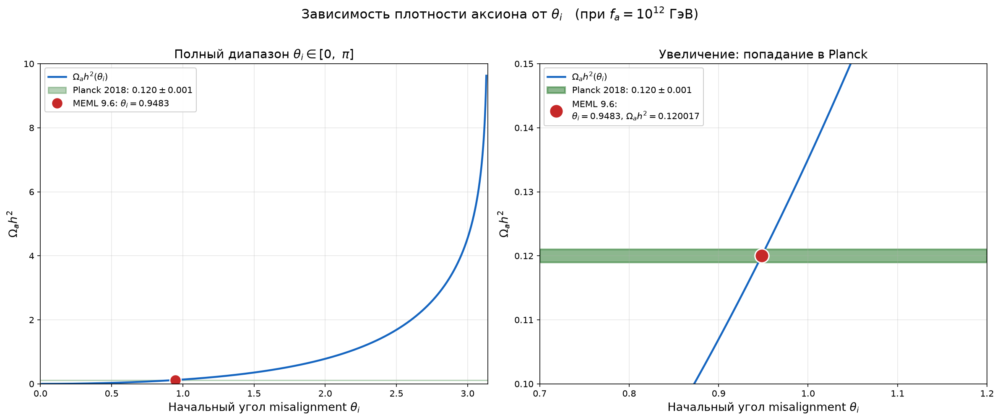

# MEML 9.6 — Аксионная тёмная материя из 6D КТП

[](https://doi.org/10.5281/zenodo.23289871)
[](https://opensource.org/licenses/MIT)
[](https://www.python.org/)

---

## О модели

MEML 9.6 — спекулятивная игрушечная модель тёмной материи в рамках 6D квантовой теории поля. Тёмная материя описывается псевдоскалярным аксионом, возникающим из фазы комплексного объёмного скалярного поля на орбифолде M₄ × T²/Z₃.

Модель является результатом последовательной эволюции от Калуца–Клейновских версий 8.1–8.3, которые оказались феноменологически несостоятельными из-за прямых ограничений криогенных детекторов XENONnT и LUX-ZEPLIN (LZ). Аксионная парадигма позволила обойти эти ограничения за счёт псевдоскалярной природы кандидата (σ_SI = 0 на древесном уровне).

### Ключевые результаты

| Параметр | Значение |
|---|---|
| Масштаб bulk-гравитации | M₆ ≈ 1.45 × 10¹⁷ ГэВ |
| Скалярный масштаб | M* ≈ 4.16 × 10¹³ ГэВ |
| Иерархия масштабов | M₆ / M* ≈ 3500 |
| Константа распада Печчеи–Квинн | f_a = 10¹² ГэВ |
| Масса аксиона | m_a ≈ 5.63 мкэВ |
| Частота сигнала | ν_a ≈ 1.36 ГГц |
| Реликтовая плотность | Ω_a h² = 0.120017 (Planck 2018) |
| Сечение рассеяния на нуклонах | σ_SI = 0 |
### Связь с чёрными дырами

| Параметр | Значение |
|---|---|
| Критическая масса ЧД | M_BH ~ 1.2 × 10⁻⁵ M_⊙ |
| Критическая масса аксионной звезды | M_crit ~ 1.6 × 10⁻⁵ M_⊙ |
| Проверка | LIGO O4/O5, EHT, PTA |
---

## График



*Зелёная полоса — Planck 2018 (0.120 ± 0.001). Красная точка — предсказание MEML 9.6 (θ_i = 0.9483, Ω_a h² = 0.120017).*

---

## Файлы

- `MEML9.6.pdf` — статья (PDF)
- `MEML9.6.tex` — исходник LaTeX
- `MEML9.6.py` — скрипт верификации
- `omega_vs_theta.png` — график Ω_a h²(θ_i)
- `requirements.txt` — зависимости Python
- `LICENSE.txt` — лицензия MIT

---

## Установка и запуск

Установите зависимости:

```
pip install -r requirements.txt
```

Запустите скрипт:

```
python MEML9.6.py
```

Ожидаемый результат: все 10 блоков верификации — PASS.

---

## Статус модели

Спекулятивная игрушечная модель — не является законченной физической теорией.

- Численно самосогласованная
- Проверяемое предсказание для ADMX (ν_a ≈ 1.36 ГГц)
- Три свободных параметра: α_G, ε, θ_i
- Открытые проблемы: петлевые поправки g_aγγ, стабильность конических дефектов, вывод α_G из SU(5)

---

## DOI

[10.5281/zenodo.23289871](https://doi.org/10.5281/zenodo.23289871)

---

## Лицензия

MIT License — см. [LICENSE.txt](LICENSE.txt)

---

## English version

### MEML 9.6 — Axion Dark Matter from 6D QFT

MEML 9.6 is a speculative toy model of dark matter in 6D quantum field theory. Dark matter is described by a pseudoscalar axion emerging from the phase of a complex bulk scalar field on the M₄ × T²/Z₃ orbifold.

The model is the result of a consistent evolution from the Kaluza–Klein versions 8.1–8.3, which proved phenomenologically untenable due to direct constraints from the cryogenic detectors XENONnT and LUX-ZEPLIN (LZ). The axion paradigm circumvents these bounds due to the pseudoscalar nature of the candidate (σ_SI = 0 at tree level).

#### Key Results

| Parameter | Value |
|---|---|
| Bulk gravity scale | M₆ ≈ 1.45 × 10¹⁷ GeV |
| Scalar coupling scale | M* ≈ 4.16 × 10¹³ GeV |
| Scale hierarchy | M₆ / M* ≈ 3500 |
| Peccei–Quinn decay constant | f_a = 10¹² GeV |
| Axion mass | m_a ≈ 5.63 μeV |
| Signal frequency | ν_a ≈ 1.36 GHz |
| Relic density | Ω_a h² = 0.120017 (Planck 2018) |
| Nucleon cross-section | σ_SI = 0 |
### Связь с чёрными дырами

| Параметр | Значение |
|---|---|
| Критическая масса ЧД | M_BH ~ 1.2 × 10⁻⁵ M_⊙ |
| Критическая масса аксионной звезды | M_crit ~ 1.6 × 10⁻⁵ M_⊙ |
| Проверка | LIGO O4/O5, EHT, PTA |
#### Files

- `MEML9.6.pdf` — paper (PDF)
- `MEML9.6.tex` — LaTeX source
- `MEML9.6.py` — verification script
- `omega_vs_theta.png` — plot Ω_a h²(θ_i)
- `requirements.txt` — Python dependencies
- `LICENSE.txt` — MIT License

#### Citation

```
Yurov, D. V. (2026). MEML 9.6 — Axion Dark Matter from 6D QFT.
Zenodo. https://doi.org/10.5281/zenodo.23289871
```
